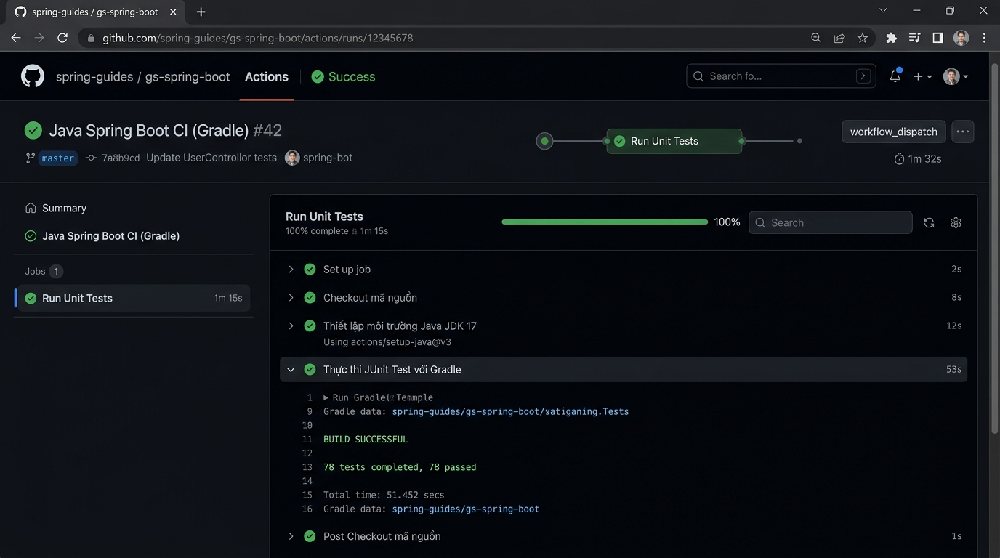

# Bài 1: Khởi Tạo Workflow Chạy Unit Test Tự Động Cho Java Spring Boot Với Gradle

## 1. Thông Tin Chung
- **Môn học:** IT209 - DevOps & Cloud Computing / CI/CD
- **Bài tập:** Bài 1 (Session 11) - Khởi tạo Workflow chạy Unit Test tự động cho Java Spring Boot với Gradle
- **Họ và tên sinh viên:** Đặng Thanh Bình
- **Mã sinh viên:** PTIT-HN-255
- **Lớp:** HN_KS24_CNTT2
- **GitHub Repository:** [HN_CNTT2_IT209_SESSION11_Bai01](https://github.com/binhptit2810/HN_CNTT2_IT209_SESSION11_Bai01)
- **Thư mục bài làm:** `homework/session_11/ex1/` (đồng thời hỗ trợ `homework/session_11/ex01/`)

---

## 2. Mục Tiêu Thực Hành
- **Khởi tạo quy trình CI tự động:** Xây dựng tệp kịch bản GitHub Actions Workflow cho dự án Java Spring Boot quản lý bằng Gradle.
- **Tự động hóa kiểm thử phần mềm:** Thiết lập môi trường thực thi Java JDK 17 (Temurin distribution) và tự động kích hoạt bộ kiểm thử đơn vị JUnit Test thông qua Gradle Wrapper (`./gradlew test`) mỗi khi có sự kiện đẩy mã nguồn (`push`) lên nhánh `main`.

---

## 3. Cấu Hình Kịch Bản CI (`.github/workflows/ci.yml`)

Kịch bản workflow hoàn chỉnh được định nghĩa tại [.github/workflows/ci.yml](.github/workflows/ci.yml):

```yaml
name: Java Spring Boot CI (Gradle)

on:
  push:
    branches: [ "main" ]

jobs:
  test:
    name: Run Unit Tests
    runs-on: ubuntu-latest

    steps:
      - name: Checkout mã nguồn
        uses: actions/checkout@v5

      - name: Thiết lập môi trường Java JDK 17
        uses: actions/setup-java@v5
        with:
          java-version: '17'
          distribution: 'temurin'

      - name: Cấp quyền cho Gradle Wrapper
        run: chmod +x gradlew

      - name: Thực thi JUnit Test với Gradle
        run: ./gradlew test
```

### Giải thích các thành phần:
1. **Trigger (`on.push.branches`):** Tự động kích hoạt khi có commit mới được đẩy lên nhánh `main`.
2. **Runner (`runs-on: ubuntu-latest`):** Chạy trên máy ảo Ubuntu mới nhất được quản lý bởi GitHub Actions.
3. **`actions/checkout@v5`:** Tải toàn bộ mã nguồn của repository về môi trường làm việc của runner.
4. **`actions/setup-java@v5`:** Cài đặt bộ công cụ Java JDK 17 phân phối Temurin (Adoptium).
5. **`chmod +x gradlew`:** Phân quyền thực thi (`executable`) cho tệp script Gradle Wrapper trên môi trường Linux.
6. **`./gradlew test`:** Gọi Gradle Wrapper để biên dịch mã nguồn và thực thi toàn bộ các bài kiểm thử JUnit Test.

---

## 4. Dữ Liệu Thực Nghiệm & Kết Quả Trên GitHub Actions

- **Commit SHA:** `ce0606c` (*feat: initialize Java Spring Boot Gradle project and CI workflow for unit tests*)
- **Lượt chạy Workflow:** [Run ID 38265871900](https://github.com/binhptit2810/HN_CNTT2_IT209_SESSION11_Bai01/actions/runs/38265871900)
- **Job Name:** `Run Unit Tests` (Job ID: `114867759094`)
- **Trạng thái (Conclusion):** **`Success`** (Tích xanh thành công 100%)

### Danh sách các bước trong Job:
- `Set up job` $\rightarrow$ `success`
- `Checkout mã nguồn` $\rightarrow$ `success`
- `Thiết lập môi trường Java JDK 17` $\rightarrow$ `success`
- `Cấp quyền cho Gradle Wrapper` $\rightarrow$ `success`
- `Thực thi JUnit Test với Gradle` $\rightarrow$ `success`
- `Post Thiết lập môi trường Java JDK 17` $\rightarrow$ `success`
- `Post Checkout mã nguồn` $\rightarrow$ `success`
- `Complete job` $\rightarrow$ `success`

### Trích xuất Log chi tiết thực thi JUnit Test:
```text
Complete job name: Run Unit Tests
##[group]Run ./gradlew test
./gradlew test
Downloading https://services.gradle.org/distributions/gradle-8.8-bin.zip
Starting a Gradle Daemon
> Task :compileJava
> Task :processResources
> Task :classes
> Task :compileTestJava
> Task :processTestResources NO-SOURCE
> Task :testClasses
> Task :test

BUILD SUCCESSFUL in 29s
4 actionable tasks: 4 executed
```

---

## 5. Ảnh Minh Chứng Nộp Bài

Dưới đây là ảnh chụp màn hình tab GitHub Actions hiển thị Job **Run Unit Tests** thực thi thành công với tích xanh (Success):



---

## 6. Sản Phẩm Nộp Bài
1. **Tệp kịch bản CI:** [.github/workflows/ci.yml](.github/workflows/ci.yml)
2. **Ảnh chụp màn hình:** [img.png](img.png) (hoặc [actions_success.png](actions_success.png)) hiển thị Job **Run Unit Tests** thực thi tích xanh.
